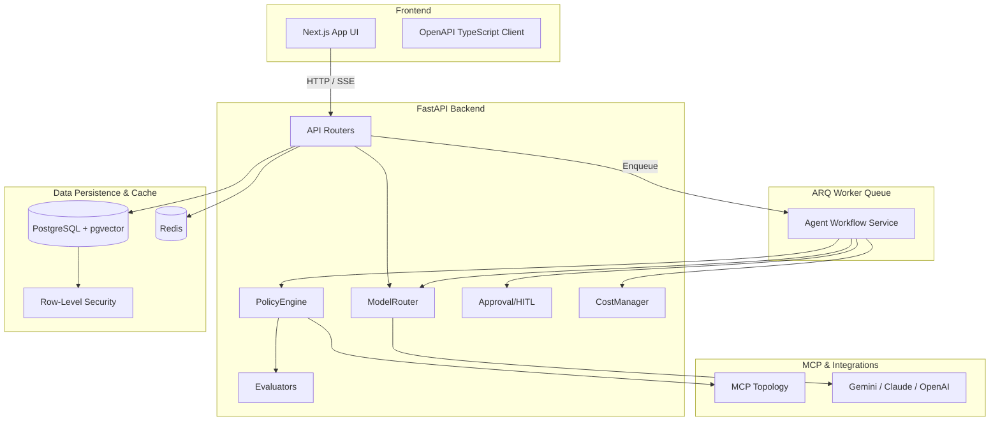

# AURA Architecture

AURA is an Autonomous AI Business Operations Engineer. It uses a Next.js frontend, a FastAPI async backend, PostgreSQL (with pgvector), Redis, and ARQ for background tasks.

## System Topology

## Core Components
- **ModelRouter**: Handles transparent failovers, backoff jitter, and routing to Gemini/Claude/OpenAI.
- **PolicyEngine**: Authorizes tool executions and strictly applies risk levels (e.g. demanding approvals for WRITE/EXTERNAL).
- **Approval/HITL**: High-risk tool calls buffer here, binding to an args hash so approvals cannot be hijacked.
- **CostManager**: Limits token budgets securely using Redis atomic counters.
- **Evaluators**: Secondary LLM checkpoints validating groundedness (preventing RAG hallucinations) before responding to the user.
- **Worker Queue**: Background ARQ processors isolating long-running LLM loops from the HTTP interface.
- **MCP Topology**: A dedicated internal MCP server providing safe external tool bridging under strict organizational isolation.
