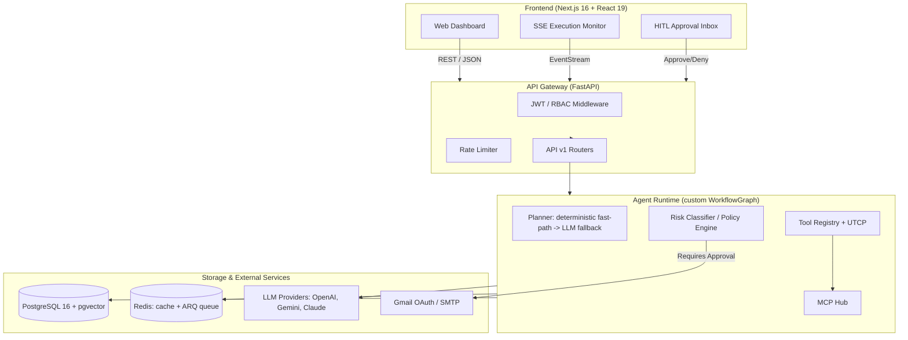

# AURA: Autonomous Enterprise AI Business Operations Platform

[](https://www.python.org/)
[](https://fastapi.tiangolo.com/)
[](https://nextjs.org/)
[](https://react.dev/)
[](https://www.postgresql.org/)
[](https://redis.io/)
[](https://www.docker.com/)
[](LICENSE)

**AURA** is an AI agent platform for business operations: it plans and executes multi-step workflows (quoting, invoicing, email-based approvals, knowledge retrieval) through a registry of typed tools, with human-in-the-loop approval gating on anything risky.

This is a solo portfolio project, built and since self-audited for correctness and security. The [full audit write-up](https://claude.ai/artifact/3T7DkLpc3sH4y6yUaYSU4o) — architecture map, verified feature inventory, security findings, and a prioritized remediation roadmap — is linked below and in **Known Limitations**. I'm linking it on purpose: it documents what I found wrong with my own code and fixed, and what I knowingly left as debt.

---

## What's actually real here

A few claims in earlier drafts of this README didn't match the code, so here's the corrected version, stated plainly:

- **The agent runtime is a custom state machine, not LangGraph.** `langgraph` and `langchain-core` were listed as dependencies but never imported anywhere in `app/` — verified with a full-repo grep before writing this. The real orchestrator is `WorkflowGraph` in `app/agents/core/graph.py`: an explicit node/transition graph (Plan → Act → Verify → Re-plan) that I wrote myself. Both unused packages have been dropped from `pyproject.toml`.
- **There's a deterministic fast path before the LLM gets involved.** For common actions (e.g. `invoice.generate`, `quotation.create_draft`) the planner first tries regex/keyword extraction against the request; only when that can't confidently fill the arguments does it fall back to an LLM call. This cuts cost and latency for routine requests, at the cost of being less flexible than "ask the LLM every time." It's a deliberate tradeoff, not a hidden shortcut — see Known Limitations for the failure mode this used to have.
- **There's a heuristic (non-LLM) fallback provider.** `HeuristicLLMProvider` is a keyword-matching stand-in that keeps the system answering (in a degraded way) if every configured LLM provider is unreachable or over quota. It's there for resilience, not as the primary "brain."

## Key Capabilities

### 1. Human-in-the-Loop (HITL) Governance & Risk Tiering
- Tools are classified by risk level (`READ`, `WRITE`, `EXTERNAL_SIDE_EFFECT`).
- Write/external actions pause execution and generate a cryptographically signed, single-use email approval link (JWT-based, bound to a hash of the specific arguments so the link can't be reused for a different call).
- An admin-only approvals inbox shows pending requests with full argument inspection; approve/reject enforces separation of duties — the user who triggered an action cannot also approve it.

### 2. Dual-Channel Email & Gmail Integration
- Google OAuth 2.0 with encrypted token storage (Fernet, tenant-derived key) and per-organization credential isolation.
- SMTP app-password fallback for providers without OAuth.
- HTML approval emails with direct approve/deny links.

### 3. Agent Execution Engine & Real-Time Traceability
- Custom `WorkflowGraph` state machine (see above) driving Plan/Act/Verify/Re-plan nodes.
- Server-Sent Events stream step-by-step execution status to the frontend.
- Falls back to the heuristic provider if configured LLM providers are unreachable.

### 4. Dynamic Tool Registry, MCP & UTCP
- Model Context Protocol (MCP) client/server for external tool servers over JSON-RPC.
- A Universal Tool Calling Protocol (UTCP) layer for schema validation and an SSRF guard on outbound tool calls.
- A small built-in business tool suite: knowledge base retrieval, quotation drafting, PDF invoice generation.

### 5. Multi-Tenant Isolation
- Every data model carries an `organization_id` foreign key, and queries are scoped to the caller's org at the application layer.
- Role-based access control (`OWNER`, `ADMIN`, `MEMBER`, `VIEWER`) enforced via a `RequireRole` FastAPI dependency on sensitive routes.
- This is **application-level** tenant isolation, not Postgres-native row-level security (no `CREATE POLICY` in the schema). See Known Limitations.

### 6. Financial Intelligence & Model Evaluation
- Per-tenant token/cost tracking and an evaluation harness for comparing model runs on latency, cost, and basic accuracy.

---

## Architecture



---

## Tech Stack

| Layer | Technologies |
| :--- | :--- |
| **Backend** | Python 3.12, FastAPI, SQLAlchemy 2.0 (async), Alembic, Pydantic v2, ARQ, AsyncPG |
| **Frontend** | Next.js 16 (App Router), React 19, TypeScript, Tailwind CSS |
| **Datastores** | PostgreSQL 16 (`pgvector` for semantic search), Redis 7.2 |
| **Agent runtime** | Custom state machine (`WorkflowGraph`) — no LangGraph/LangChain dependency |
| **LLM providers** | OpenAI, Google Gemini, Anthropic, plus a keyword-based heuristic fallback |
| **Tooling & standards** | Model Context Protocol (MCP), Universal Tool Calling Protocol (UTCP), OpenAPI 3.1 |
| **DevOps & QA** | Docker Compose, Pytest, Pytest-Asyncio, Ruff, ESLint, GitHub Actions |

---

## Repository Structure

```text
AURA-FINAL/
├── backend/
│   ├── app/
│   │   ├── agents/          # WorkflowGraph state machine, nodes, planning engine
│   │   ├── ai/              # Multi-provider LLM integrations + heuristic fallback
│   │   ├── api/             # FastAPI REST endpoints and v1 routes
│   │   ├── config/          # App settings, environment schema
│   │   ├── database/        # SQLAlchemy 2.0 async models
│   │   ├── evaluation/      # Model evaluation engine, cost tracking
│   │   ├── knowledge/       # RAG pipeline, document ingestion, embeddings
│   │   ├── observability/   # Structured logging, error handlers
│   │   ├── security/        # Credential vault (Fernet encryption)
│   │   └── tools/           # Tool registry, UTCP engine, MCP client/server
│   ├── migrations/          # Alembic database migrations
│   ├── scripts/             # DB seed scripts, demo utilities
│   └── tests/               # Pytest suite (194 tests at last count)
├── frontend/
│   └── src/app/             # Dashboard, approvals inbox, conversations, settings, etc.
├── docker-compose.yml       # Local/dev container orchestration
├── .env.example             # Environment configuration template
└── README.md
```

---

## Quickstart

### Prerequisites
- Docker Desktop (24+)
- Node.js (v20+ LTS)
- Python (3.12+)

### 1. Configure environment
```bash
cp .env.example .env
```
Edit `.env` — at minimum set `AURA_SECRET_KEY` and one LLM provider key (`GEMINI_API_KEY` or `OPENAI_API_KEY`).

### 2. Run with Docker Compose
```bash
docker compose up -d --build
docker compose exec backend alembic upgrade head
docker compose exec backend python scripts/seed_data.py
```

### 3. Or run locally
```bash
# Backend
cd backend
python -m venv .venv
source .venv/bin/activate  # Windows: .venv\Scripts\activate
pip install -r requirements.txt
alembic upgrade head
python scripts/seed_data.py
uvicorn app.main:app --reload

# Frontend (separate shell)
cd frontend
npm install
npm run dev
```

- Frontend: http://localhost:3000
- API docs: http://localhost:8000/docs
- Health check: http://localhost:8000/api/v1/health

---

## Testing & CI

```bash
cd backend
pytest -v              # 194 tests
ruff format --check .
ruff check .            # currently non-blocking in CI — see Known Limitations
mypy app                # currently non-blocking in CI — see Known Limitations
```

CI (`.github/workflows/ci.yml`) runs format checks and the full test suite as real, blocking gates — a failure fails the build. Lint and type-checking still run on every push but don't block merge yet, for the reason in the next section.

---

## Known Limitations

Written honestly rather than omitted. Full detail and severity ratings are in the [self-audit](https://claude.ai/artifact/3T7DkLpc3sH4y6yUaYSU4o).

- **Lint/type debt is real and visible, not hidden.** `ruff check` currently reports ~128 pre-existing findings across the codebase (mostly stylistic — `Path.open()` vs `open()`, a few unsafe-to-autofix patterns) and `mypy` hasn't been run to a clean baseline. Both still run on every CI push so the debt doesn't silently grow, but neither blocks a merge yet.
- **Tenant isolation is application-level, not database-native.** Every table has an `organization_id` and every query path filters on it, but there's no Postgres `ROW LEVEL SECURITY` policy as a second line of defense — a bug in a query's `WHERE` clause is the only thing standing between tenants today.
- **No SSO.** Auth is JWT + bcrypt only; there's no SAML/OIDC integration.
- **The "deterministic fast path" used to fabricate data on a miss, and that's been fixed.** Two call sites silently defaulted an unrecognized customer name to a hardcoded "Acme Technologies" instead of asking the LLM or failing. Both now either route to the real LLM-based fallback or raise a validation error — see commit history on this repo for the fix.
- **A handful of admin endpoints previously faked success** (a "credentials saved" response that never persisted anything; health-check endpoints that always reported healthy regardless of the actual probe result). Fixed to reflect real state — again, visible in commit history rather than claimed here without evidence.
- **Single-region deployment, no horizontal scaling story yet.** This is a portfolio deployment, not a production SLA.

If you're evaluating this as a hiring signal: the audit linked above and the commit history are the actual evidence. I'd rather you find three disclosed limitations than one undisclosed bug.

---

## Security & Governance

- Tools require risk-level authorization and UTCP schema validation before execution.
- Secrets/tokens encrypted at rest (Fernet, tenant-derived key).
- Structured audit logging with `trace_id` / `org_id` / `user_id` context on every tool invocation.
- Login endpoint has a dedicated, tighter rate limit (separate bucket from the general API limiter) to blunt credential brute-forcing.
- `.gitignore` covers local scratch scripts, dumps, and credential files so they can't be accidentally committed.

---

## License

MIT — see [LICENSE](LICENSE).
