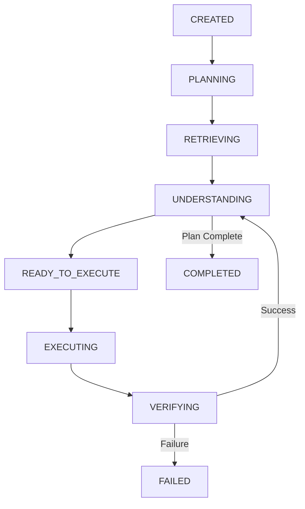

# AURA Agentic Workflow Engine

Phase 4 introduces a strict, observable state machine to drive AURA's AI operations. This replaces uncontrolled LLM loops with a deterministic graph.

## Architecture

The engine uses a typed state machine where transitions and nodes are explicit.

## Key Components

1. **State Machine**: Powered by `WorkflowGraph` in `app.agents.core.graph`. It enforces bounded iterations, timeouts, and structured state transitions.
2. **AgentState**: A strictly typed Pydantic model (`app.agents.core.state`) preserving the exact execution context (history, actions, context, plan) across iterations.
3. **Planner**: Transforms user intents into structured action graphs (`StructuredAgentPlan`).
4. **Action Registry**: Binds semantic intents (e.g. `CREATE_QUOTATION_DRAFT`) to concrete, safe Python execution handlers (`ActionExecutor`).
5. **Retrieval**: Integrates natively with `pgvector` RAG services for grounding workflow context.

## Quotation Workflow

The first flagship workflow implemented is the `Quotation Workflow`.
The planner breaks this down into:
1. `RETRIEVE_CUSTOMER`
2. `RETRIEVE_PRODUCT`
3. `CALCULATE_QUOTATION` (Deterministic financial math)
4. `CREATE_QUOTATION_DRAFT`

## Security Boundaries
1. The LLM cannot execute arbitrary Python.
2. Financial totals are calculated via deterministic actions, not LLM math.
3. Every operation emits an observable trace.
