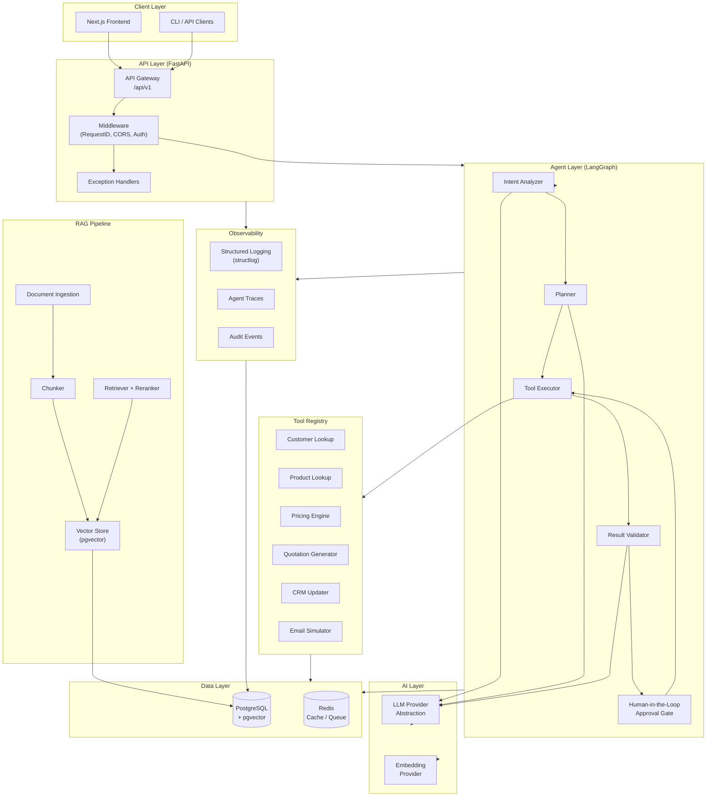
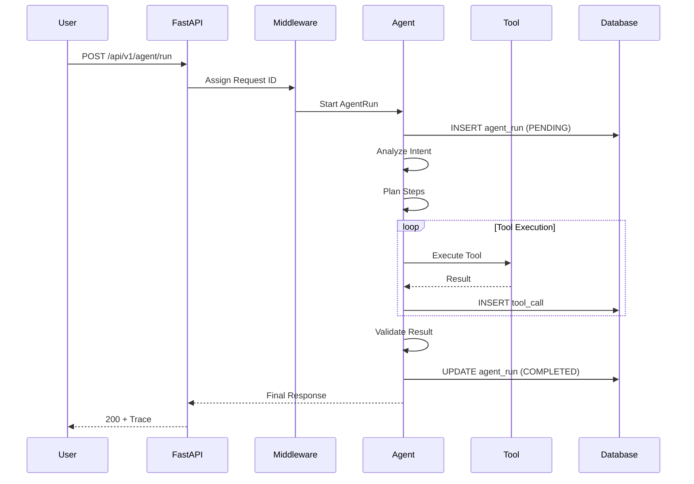
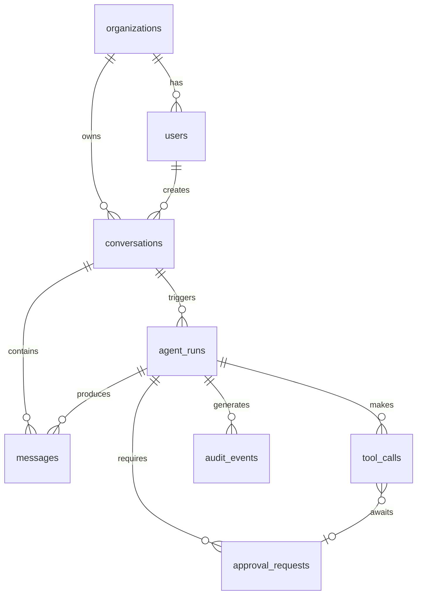

# AURA Architecture

This document describes the high-level architecture of AURA — Autonomous AI Business Operations Engineer.

## System Overview



## Component Responsibilities

### API Layer
The FastAPI application serves as the entry point for all external interactions.
Key responsibilities:
- Request validation (Pydantic)
- Authentication / authorization (Phase 7)
- Request ID assignment and propagation
- Routing to domain handlers
- Structured error responses

### Agent Layer
The agent orchestrates multi-step business workflows through a controlled state machine.
Key design decisions:
- **Explicit state transitions** — no hidden autonomous loops
- **Maximum iteration cap** — prevents runaway agents
- **Hard timeout** — guarantees bounded execution time
- **Human-in-the-loop gate** — high-impact actions require approval
- **Full execution trace** — every decision is recorded

### Tool Registry
Tools are the agent's actuators — the only way it can affect the outside world.
Each tool has:
- Explicit input/output schema
- Permission requirements
- Timeout configuration
- Mock/real adapter separation

### RAG Pipeline
Retrieval-Augmented Generation for enterprise knowledge.
- Document ingestion with metadata
- Semantic chunking with overlap
- pgvector similarity search
- Reranking for precision
- Source attribution on every answer

### Data Layer
PostgreSQL is the single source of truth.
- All agent runs, traces, and audit events persist here
- pgvector stores embeddings in the same database
- Redis handles ephemeral state (rate limiting, session cache, task queues)

## Request Flow



## Database Schema (Phase 1)



## Security Model

```
┌─────────────────────────────────────────────────────┐
│                  Trust Boundary                      │
│                                                      │
│  User Input ──► Validation ──► Agent                │
│                                                      │
│  Retrieved Docs ──► [UNTRUSTED] ──► Context Window  │
│  Tool Outputs   ──► [UNTRUSTED] ──► Agent           │
│                                                      │
│  Agent can only act through Tool Registry           │
│  Tool Registry enforces permissions                 │
│  High-impact tools require human approval           │
│                                                      │
└─────────────────────────────────────────────────────┘
```

## Technology Decisions

See `docs/decisions/` for detailed Architecture Decision Records (ADRs).
